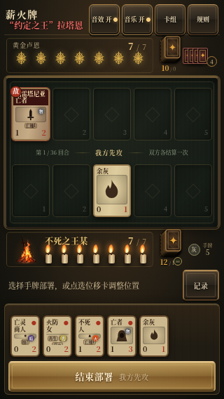

# 薪火牌 · 姓名标识与普通卡平衡版 0.12

`index.html` 是完整单文件游戏，图像、GIF、字体和音效全部内嵌，无需安装依赖或配置后端。打开即显示首页，保留撤除阻塞加载页的修复。

## 试玩与下载

- [打开试玩网页](https://flightwilliams.github.io/FlightWilliams/game/)
- [下载试玩ZIP](https://github.com/FlightWilliams/FlightWilliams/raw/refs/heads/main/game/xinhuo-demo.zip)，解压后打开 `index.html`。

## 0.12 更新

Boss名字在原左上位置改为红色并加大；玩家姓名在自己生命值旁用金色、相同字号显示。桌面15px，手机及窄横屏12px；最窄320px下48位Boss长名均完整显示，篝火、姓名、生命数字和按钮不重叠。

全库880张普通牌审计后，139张无技能牌提高生命，222张技能收益过高的牌降低攻防；519张不变。相同费用下，无技能与单技能牌拥有更高身材，多技能牌以身材换效果。保留所有角色能力、费用、道顺1攻，以及48张金辉的全部数值和技能。新旧死亡身份与载入的沿用卡组采用同一套普通模板规则，不修改战斗中的成长增益。

详见[平衡说明](BALANCE.md)与[361张调整明细CSV](card-balance-changes.csv)。

## 延续的操作与轮回机制

普通点牌与祭品选择只更新选中框、说明和操作按钮，保留牌桌、手牌和篝火节点。手牌按固定五张宽度布局，不随抽牌数量改变尺寸；牌多时横向滚动。抽牌保留210毫秒从牌堆到手牌的平移动画，取消缩放、旋转及落地弹跳；动画异常时也会释放输入，不会留下隐藏牌。

同场景4倍CPU降速、热身后30次采样，点击事件与同步布局中位耗时：手机5张40.0→2.3毫秒、手机24张71.3→2.5毫秒、桌面5张41.5→4.3毫秒、桌面24张99.0→6.3毫秒。这是Chromium模拟数据，不代表真实iPhone整帧耗时。

三重轮回各有16位不同Boss，合计48位，具有不同技能配置、战败不甘台词和玩家死亡回响。道顺攻击由0改为1。48位Boss均有同名金辉版本，攻防高于普通版，费用相同，最高4攻6血；旧20种金卡名称与收藏兼容。

普通通关整组奖励仍以5%概率出现当前Boss的金辉，三张候选选一张。深渊最后一关必定出现三张已击败Boss的金辉，包含最终Boss贝勒；玩家可改选，选满两张后确认，一次领取两张。

完成16关后，将出战卡组、备用牌和已击败Boss记录保存给下一档难度。最后奖励也会加入保存；首页卡组管理可编辑这副沿用卡组。余火→薪火→深渊不再重置成16张，深渊重玩也沿用；出战最多36张，同名最多2张，余灰除外。超出上限的奖励进入备用。

## 三轮48位Boss

| 关卡 | 余火 | 薪火 | 深渊 |
|---:|---|---|---|
| 1 | 塔楼骑士 | 贯穿骑士 | 铠甲蜘蛛 |
| 2 | 老王奥兰特 | 风暴王 | 少女阿斯特蕾亚 |
| 3 | 不死院恶魔 | 月光蝶 | 墓王尼特 |
| 4 | 薪王葛温 | 亚尔特留斯 | 深渊之主马努斯 |
| 5 | 追逐者 | 公爵的芙蕾雅 | 熔铁恶魔 |
| 6 | 灼烧的白王 | 镜之骑士 | 烟之骑士雷姆 |
| 7 | 深渊守望者 | 冷冽谷的玻尔多 | 薪王们的化身 |
| 8 | 盖尔 | 教宗沙力万 | 黑龙米狄尔 |
| 9 | 加斯科因 | 教会野兽 | 路德维希 |
| 10 | 科斯孤儿 | 格曼 | 玛丽亚 |
| 11 | 鬼刑部 | 蝴蝶夫人 | 狮子猿 |
| 12 | 一心 | 弦一郎 | 怨恨之鬼 |
| 13 | 葛瑞克 | 蕾娜拉 | 玛尔基特 |
| 14 | 艾尔登之兽 | 玛莲妮亚 | 拉达冈 |
| 15 | 神兽舞狮 | 双月骑士蕾菈娜 | 树影化身 |
| 16 | “约定之王”拉塔恩 | “穿刺者”梅瑟莫 | “暴虐”贝勒 |

Boss死亡余音和玩家失败回响分别编写；即使死于该关小怪，回响仍由当前Boss发出。新生成的死亡身份保留该句回响，永久归档后仍可查看。

## 收藏、组牌与死亡身份

基础卡库共928张角色卡，其中48张金辉；另外提供余灰与永久归档的死亡身份。未获得的卡以问号背面封存，不显示名称、能力或加入按钮，搜索只匹配已收藏卡。默认起始16张中的12种角色及余灰作为初始收藏。

奖励实际进入出战后才永久解锁；只进入备用时保持封存，须编入出战并保存。出战12–36张，推荐24张，同名最多2张，余灰豁免同名限制。达到36张后才提示整理，排序仅影响显示。新创建的起始自定义卡组保留费用、Boss比例与零费比例限制；跨轮回取得的卡组不会因这些初始预算被重置。

每个16关轮回最多暂存一张死亡身份；首次死亡自动保留，第二次及以后选择保留旧身份或替换新身份。重试只带一张暂存身份。完成本轮16关后，该身份才永久归档并可自由组卡。暂存、收藏、晋阶和跨轮回卡组保存在当前浏览器；正在进行的小关不自动续存。

## 48张金辉卡

普通Boss版本仍保留，金卡显示金色边框、箔面和星点；减少动画模式停用扫光。成长仅由自身攻击击杀敌卡触发，每击杀+1攻，仅本次战斗有效；直击生命、献祭、中毒击杀不触发。亡语在死亡和献祭时触发，敌我一致。小蜘蛛与金色余灰为召唤物，不计入48张收集卡；本回合诞生须到下回合才可献祭。

| 金辉Boss | 攻 / 血 / 费 | 技能 |
|---|---:|---|
| 公爵的芙蕾雅·金辉 | 3 / 6 / 3 | 毒刃、亡语召唤两只小蜘蛛 |
| 亚尔特留斯·金辉 | 4 / 5 / 3 | 守护、横移、击杀成长 |
| 盖尔·金辉 | 4 / 5 / 3 | 横移、击杀成长 |
| 塔楼骑士·金辉 | 3 / 6 / 3 | 守护、击退 |
| 月光蝶·金辉 | 3 / 4 / 3 | 飞行、横移 |
| 玛莲妮亚·金辉 | 4 / 4 / 3 | 嗜血、横移 |
| 薪王葛温·金辉 | 4 / 4 / 3 | 弹反、引火、亡语回复2生命 |
| 墓王尼特·金辉 | 4 / 5 / 3 | 遗骨、亡语召唤金色余灰 |
| 格曼·金辉 | 4 / 4 / 3 | 弹反、横移、亡语抽2张 |
| 灼烧的白王·金辉 | 3 / 6 / 3 | 守护、亡语回复2生命 |
| 鬼刑部·金辉 | 3 / 6 / 3 | 守护、击退 |
| 蝴蝶夫人·金辉 | 4 / 4 / 3 | 飞行、换位、亡语抽2张、出场抽1张 |
| 一心·金辉 | 4 / 4 / 3 | 弹反、横移、出场抽1张 |
| 贯穿骑士·金辉 | 4 / 5 / 3 | 击退、击杀成长 |
| 风暴王·金辉 | 3 / 4 / 3 | 飞行、亡语抽2张 |
| 少女阿斯特蕾亚·金辉 | 4 / 4 / 3 | 再生、引火、亡语回复2生命、出场回复1生命 |
| “穿刺者”梅瑟莫·金辉 | 4 / 4 / 3 | 嗜血、击退、击杀成长 |
| 神兽舞狮·金辉 | 3 / 6 / 3 | 守护、击退、出场抽1张 |
| 双月骑士蕾菈娜·金辉 | 4 / 4 / 3 | 弹反、横移、亡语抽2张、出场抽1张 |
| 树影化身·金辉 | 4 / 4 / 3 | 再生、复燃、亡语召唤金色余灰 |
| 老王奥兰特·金辉 | 4 / 5 / 3 | 嗜血、出场抽1张 |
| 不死院恶魔·金辉 | 4 / 5 / 3 | 荆棘、击退 |
| 追逐者·金辉 | 3 / 4 / 2 | 守护、横移 |
| 深渊守望者·金辉 | 4 / 5 / 3 | 弹反、横移、复燃 |
| 加斯科因·金辉 | 4 / 4 / 3 | 弹反、横移 |
| 科斯孤儿·金辉 | 4 / 5 / 3 | 弹反、击退 |
| 葛瑞克·金辉 | 3 / 6 / 3 | 守护、击退、击杀成长、出场回复1生命 |
| 艾尔登之兽·金辉 | 3 / 6 / 3 | 飞行、出场回复1生命 |
| “约定之王”拉塔恩·金辉 | 3 / 6 / 3 | 守护、横移、出场回复1生命 |
| 镜之骑士·金辉 | 3 / 6 / 3 | 荆棘、出场抽1张 |
| 冷冽谷的玻尔多·金辉 | 4 / 5 / 3 | 嗜血、横移、亡语回复2生命 |
| 教宗沙力万·金辉 | 4 / 4 / 3 | 弹反、换位、亡语抽2张 |
| 教会野兽·金辉 | 4 / 4 / 3 | 再生、击退 |
| 弦一郎·金辉 | 4 / 4 / 3 | 弹反、击退、出场抽1张 |
| 蕾娜拉·金辉 | 4 / 5 / 3 | 飞行、出场抽1张、出场回复1生命 |
| 铠甲蜘蛛·金辉 | 3 / 6 / 3 | 守护、亡语召唤两只小蜘蛛 |
| 深渊之主马努斯·金辉 | 4 / 5 / 3 | 击退、汲魂 |
| 熔铁恶魔·金辉 | 3 / 6 / 3 | 荆棘、引火 |
| 烟之骑士雷姆·金辉 | 3 / 6 / 3 | 嗜血、击退 |
| 薪王们的化身·金辉 | 4 / 4 / 3 | 再生、横移、复燃 |
| 黑龙米狄尔·金辉 | 3 / 4 / 3 | 飞行、击退 |
| 路德维希·金辉 | 3 / 6 / 3 | 嗜血、击退、出场回复1生命 |
| 玛丽亚·金辉 | 4 / 4 / 3 | 嗜血、横移、击杀成长 |
| 狮子猿·金辉 | 4 / 4 / 3 | 再生、击退、复燃 |
| 怨恨之鬼·金辉 | 4 / 5 / 3 | 荆棘、击退、击杀成长 |
| 玛尔基特·金辉 | 3 / 6 / 3 | 弹反、击退、汲魂、出场抽1张 |
| 拉达冈·金辉 | 4 / 4 / 3 | 弹反、引火、亡语回复2生命 |
| “暴虐”贝勒·金辉 | 3 / 4 / 3 | 飞行、击退、击杀成长 |

## 战斗与操作

双方7生命、五格战场、5张起手。攻击只打对位；飞行可越过对位，守护可拦截。新部署卡可以攻击，存活至下回合才可献祭。从第二回合免费获得一张余灰，再从有限卡组抽一张或再取无限余灰。最多36回合，之后按生命与场面裁决。

帕奇可冻结一张自己的手牌两回合，第三回合解冻并减1费，最低0。介绍：“这个光头总是在你不经意时，将你推下深渊”。右键、Esc或手机“取消”清除待确认选择；已完成的部署与移动不撤销。

点牌堆图标打开卡组，按费用、功能、属性或名称排序。手机长按卡牌约半秒查看完整介绍与能力；锁定卡不能打开。新手先进行界面导览，再练习两回合，可在规则中重看。界面适配桌面与iPhone尺寸，手牌和说明独立滚动。

首页保留对宫崎英高的致敬、对《邪恶冥刻》的创作缘起，以及右下角金色小字作者：Will Wang。

## 音效与设计来源

洗牌、抽牌、落牌使用[Kenney Casino Audio](https://kenney.nl/assets/casino-audio)纸牌录音；燃烧采用Ezwa／Dinamic的Flare火焰录音改编（CC-BY-SA 3.0）。刀剑来自audione，怪物与弓箭来自Superpowers，重击来自Kenney；圣光、灵体、法术和金辉宝石提示为原创合成。全部音频内嵌，音效与音乐独立，关闭音效即时停止。逐项来源、独立改编WAV及完整许可见[audio/](audio/)。

按钮与牌桌参考Wesnoth与Forge，成品使用原创CSS，详见[设计参考](DESIGN.md)。

## 验证与限制

本版选择12项、抽牌9项、跨轮回与最终奖励26项、核心战斗13项、开局AI16项、收藏身份22项、晋阶14项、新手教学8项、长按10项、主牌桌8种尺寸通过。Boss战役12项、金辉成长亡语22项、战斗音色12项也通过；记录随试玩ZIP附带。

手机验证来自Chromium模拟，尚未进行真实iPhone微信/Safari验证。记录没有账户或云同步，换浏览器、清站点数据或换域名会影响本地进度。GitHub Pages网址在部分网络环境的可达性由网络决定。卡表为同人设计，未逐项穷尽全部官方角色与译名。
