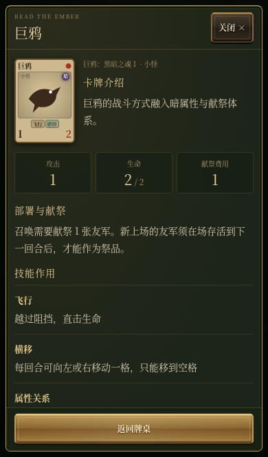

# 薪火牌 · 帕奇深渊陷阱版 0.8.2

`index.html` 是完整游戏，图像、GIF、音效全部内嵌，无需安装依赖或配置后端。`xinhuo-demo.zip` 是可下载的发布包。

## 试玩与下载

- GitHub Pages 部署完成后的游戏路径：[/FlightWilliams/game/](https://flightwilliams.github.io/FlightWilliams/game/)
- [下载试玩 ZIP](https://github.com/FlightWilliams/FlightWilliams/raw/refs/heads/main/game/xinhuo-demo.zip)，解压后用浏览器打开 `index.html`。

## 帕奇 · 深渊陷阱

帕奇出场时，可选择自己的一张手牌冻结两回合：本回合与下一回合不能打出，第三回合开始自动解冻，献祭费用减少1，最低0费。手牌显示冻结倒计时，详情中也能查看状态；右键、Esc或“跳过”可放弃本次效果，已完成的部署不会撤回。敌方帕奇遵循相同规则，冻结与减费只在当前对战中有效。

精确名称“帕奇”的旧换位与抽牌能力已替换，卡牌介绍改为：“这个光头总是在你不经意时，将你推下深渊”。卡组功能排序新增“控制与减费”。

专项13项通过，覆盖实际部署与目标选择、两轮冻结、解冻减费一次、最低0费、同名实例隔离、敌方AI、取消、无目标及跨关重置；原战斗13项、8种窗口响应式检查通过。手机验证来自Chromium模拟。

## 微信直开、长按与Boss余音

0.8.1 已撤掉阻塞式加载页，打开链接后直接显示首页。首页不再等待动画帧、图片decode或字体加载，避免微信内置浏览器停在进度条上。其余图像继续由浏览器显示，音频由首次触摸或点击解锁。

已模拟iPhone微信UA及动画帧/图片decode永不返回，验证首页可见、可开始16张卡组与5张起手的对局、可打开卡组查看。尚未在真实iPhone微信验证，欢迎从最新链接复测。

手机长按卡牌约半秒，可查看角色介绍、攻防、献祭费用与技能作用。适用于手牌、双方战场、奖励、图鉴和卡组管理；滑动或多点触摸会取消长按，松手不会误出牌或领奖。关闭详情后保留当前选择、管理草稿和滚动位置。

手机长按卡牌详情

每关Boss战败后显示一句符合其角色特点的原创不甘台词，并记录在战斗日志中。补正了失落王冠与神之门的Boss名称匹配，分别使用灼烧的白王与“约定之王”拉塔恩。

发牌与抽牌使用原创合成的经典蜘蛛纸牌风格轻响，没有使用Windows原始录音；战斗音效和独立音乐开关保留。奖励边界、长按8项与3项边界补验、全部16关Boss台词与集成音效检查通过。

## 我的卡组

首页点击带牌堆图案的“我的卡组”；对战中点击顶部“卡组”或我方牌堆即可查看。推荐24张、出战上限36张，旧版12张起始卡组仍兼容；新玩家默认初始卡组16张，起手仍为5张；推荐24张模板可单独选择。已有的自定义卡组与遗骸规则保留。

支持按费用、功能、属性、名称分组排序，切换升降序，搜索名称或技能，以及查看完整卡牌详情。排序只改变显示，不会改变实际抽牌顺序。

战斗中为只读查看。过关领取的奖励会直接加入卡组并进入下一关；不因超过24张或已有备用牌而中断。出战达到36张后才自动打开整理面板，可以保留当前数量，也可在出战与备用间调换：先“移入备用”，再到“备用牌”把需要的牌“加入出战”。满36张时，新奖励先放入备用，遗骸也遵守上限。备用牌不进入抽牌堆。

修改先进入草稿，取消、关闭或Esc会放弃本次改动；点击“保存卡组”后返回篝火，再继续下一关。关间整理不会覆盖首页保存的起始卡组。备用与奖励只在本轮冒险中保留，当前对局仍不自动续存。

首页的“全部卡牌”可从880张卡牌中组建12–36张起始卡组，保存后在当前浏览器下次开局生效。同名最多2张；总费用上限为卡数×22/12向上取整，Boss上限为卡数/4向上取整，零费卡上限为卡数/6向上取整。推荐24张模板可一键恢复。

手机关间整理

卡组与奖励流程验证覆盖默认16张、推荐24张、旧卡组兼容、36张边界、奖励防重复与最终通关；费用/功能/属性排序、备用牌、取消草稿和只读查看沿用已验证流程。

## 新手指引与首页致敬

首次进入先进行12项界面导览，金框和箭头解释控制按钮、双方生命、牌堆与手牌、战斗格、余灰、抽牌和结束部署。点击任意位置或“下一项”继续，导览不会修改游戏状态；之后进入两回合练习：部署余灰、等待一轮、选择抽牌、标记祭品、确认召唤，再观察普通卡对位攻击与巨鸦飞行直击。

新上场的牌须存活到下一回合才能献祭；新牌仍能参与本回合攻击。从第二回合起，先免费获得一张余灰，再在“抽卡组”和“再取余灰”中选择一次。卡组有限、余灰无限；飞行可越过对位卡，守护能够拦截飞行。

练习可跳过，完成或跳过后进入正式第一关；可从“玩法手册 → 重看新手指引”再次练习。练习不计入通关和死亡遗骸，首次引导状态记于当前浏览器。重看会开始新的练习，当前对局不续存。

首页增加对宫崎英高的致敬，介绍作者作为魂游戏和卡牌游戏玩家，受《邪恶冥刻》启发独自制作本作的缘起。首页开始按钮简化为“点燃余火”；右下角署名为“作者：Will Wang”。手写署名字体已嵌入，无需额外网络加载，其SIL开放字体许可也包含在HTML与试玩包内。

查看手机新手指引

界面导览5项（四视口48个高亮目标）与两回合练习7项通过；原战斗13项、晋阶14项、取消/布局15项和8种窗口回归均通过。

## 自适应牌桌

桌面使用宽牌桌与侧边信息栏；手机使用紧凑生命栏、五格战场和底部操作区。主牌桌按可视窗口高度布局；手牌较多时局部横向滑动。规则、战斗记录与完整卡牌说明通过独立滚动面板查看。

增加动态可视高度、iPhone安全区域与横竖屏切换适配。手机主要按钮至少44px，姓名输入文字16px。首页右下角显示“作者：Will Wang”；“作者：”使用11px金色微软雅黑字体（无该字体的设备回退到系统无衬线字体），Will Wang使用14px金色内嵌手写字体。

已在Chromium验证1920×1080、1366×768、1280×720、390×664、393×759、375×635、320×568、844×390，并模拟安全区与工具栏压缩后的可视高度。尚未进行真实iPhone Safari测试。

查看手机布局

## 取消选择与双方布局

选错时按鼠标右键或Esc，即可清除手牌、祭品和位移选择；手机点击“取消”。已经完成的出牌或移动不会撤回，结算和抽牌动画期间不执行取消。首页也显示这条操作说明。

双方生命栏左对齐、宽度一致；双方牌库统一在各自生命栏右侧，牌堆尺寸、叠层和计数布局保持一致。

## 规则与进阶

双方五张起手、五格战场、七点生命；横移、换位、击退、守护、吸血、持续伤害等能力采用统一结算。880张同人卡牌可在图鉴中搜索和组牌。卡表尚未逐项穷尽或核对全部官方角色与变体。

难度按余火 → 薪火 → 深渊顺序推进，通关当前16关才开启下一档。晋阶记录保存在当前浏览器，当前对局不自动续存。

## 视觉参考

参考[Wesnoth古铜按钮](https://github.com/wesnoth/wesnoth/tree/master/images/buttons)与[Forge卡牌桌面](https://github.com/Card-Forge/forge/tree/master/forge-gui/res/skins/default)，使用原创CSS实现烟熏木色、黄铜细框、炭黑刻槽和旧金按钮，未复制参考项目图像进游戏。详情见[设计参考](DESIGN.md)。
