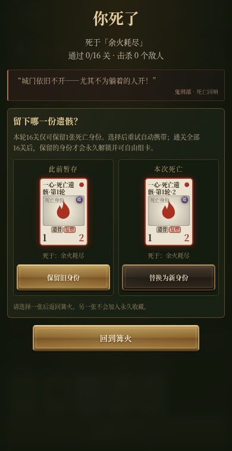
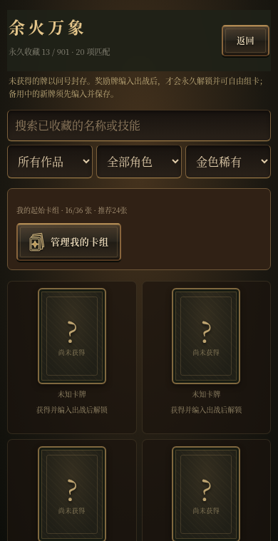
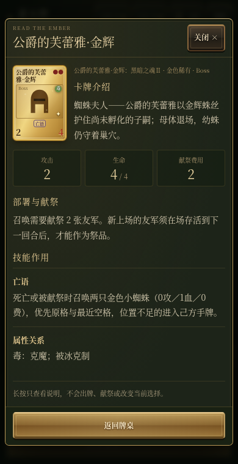
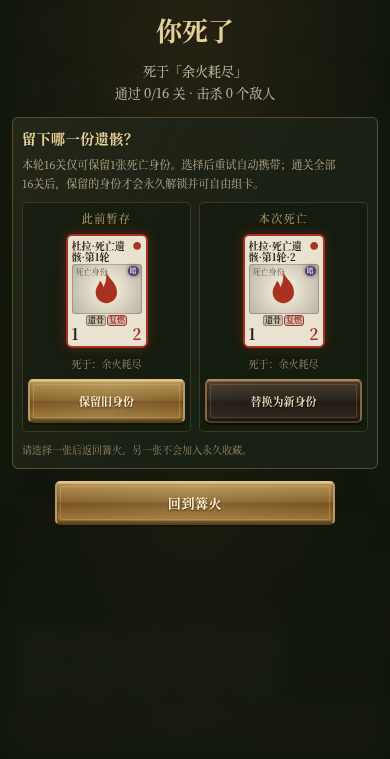

# 薪火牌 · 战斗音色与Boss回响版 0.10

`index.html` 是完整单文件游戏，图像、GIF、字体和音效全部内嵌。无需安装依赖或配置后端，打开后直接显示首页。

## 试玩与下载

- [打开试玩网页](https://flightwilliams.github.io/FlightWilliams/game/)
- [下载试玩 ZIP](https://github.com/FlightWilliams/FlightWilliams/raw/refs/heads/main/game/xinhuo-demo.zip)，解压后打开 `index.html`。

## 0.10 更新：燃烧、分类攻击、治疗与金辉提示

献祭燃烧改为真实火焰噼啪录音。卡牌攻击按主要角色与武器分类，双方使用同一规则：

| 类别 | 攻击声音示例 |
|---|---|
| 骑士、持刀剑的人类 | 刀剑挥砍与剑刃接触 |
| 野兽、怪物 | 兽吼；乌鸦类使用鸟鸣，火牛类使用牛吼 |
| 弓箭与远程 | 弓弩射击 |
| 法师、施法者 | 法术迸发 |
| 灵体、永久死亡身份 | 灵魂回响 |
| 巨锤、石像、重型单位 | 金属重击 |

分类优先采用角色与武器特征，避免把火属性骑士误认成法师；金辉卡继承普通版本的分类。攻击每次只播放一次对应音效，正常和减少动画模式一致。

带引火、出场回血或余火回血的牌部署时播放圣光治疗音；死亡回血也在实际生效时播放。出现5%金辉奖励时，以清脆的原创宝石“叮”声替代普通胜利提示，重复打开说明或重绘不会再响。音效与音乐开关仍独立，关闭音效会立即停止燃烧和战斗声音。

素材与改编文件位于[audio/](audio/)，包含完整来源、独立WAV与许可。火焰采用Ezwa／Dinamic的Flare火焰录音改编（CC-BY-SA 3.0），刀剑来自audione，怪物与弓箭来自Superpowers，重击来自Kenney；圣光、灵体、法术和宝石提示为本作原创合成。怪兽吼叫是幻想音效；金辉提示没有使用原游戏语音或录音。

## 16关Boss名称与死亡回响

每档难度仍为16小关，沿既有作品与Boss顺序，以对应Boss命名。Boss战败余音与玩家失败时的死亡回响分别编写；玩家即使死于该关小怪，回响仍由当前Boss发出。新生成的死亡身份会保留该句回响，永久归档后也可查看。

| 小关 | 对战Boss |
|---:|---|
| 1 | 恶魂 · 塔楼骑士 |
| 2 | 恶魂 · 老王奥兰特 |
| 3 | 魂Ⅰ · 不死院恶魔 |
| 4 | 魂Ⅰ · 薪王葛温 |
| 5 | 魂Ⅱ · 追逐者 |
| 6 | 魂Ⅱ · 灼烧的白王 |
| 7 | 魂Ⅲ · 深渊守望者 |
| 8 | 魂Ⅲ · 盖尔 |
| 9 | 血源 · 加斯科因 |
| 10 | 血源 · 科斯孤儿 |
| 11 | 只狼 · 鬼刑部 |
| 12 | 只狼 · 一心 |
| 13 | 法环 · 葛瑞克 |
| 14 | 法环 · 艾尔登之兽 |
| 15 | 幽影 · 神兽舞狮 |
| 16 | 幽影 · “约定之王”拉塔恩 |

新功能专项12项和手机死亡选择6条路径通过；分类覆盖900张角色卡、100个代表与边界名称及20张金辉继承。原核心13项、第一关AI16项、收藏身份22项通过，无JavaScript错误。手机验证来自Chromium模拟。

## 0.9.1 更新：纸牌录音与第一关策略

洗牌、抽牌与双方落牌改用 [Kenney Casino Audio](https://kenney.nl/assets/casino-audio) 的纸牌录音，包含洗牌、扇牌、三种滑牌与两种落桌声音。音量与高频已作柔化，连续发牌控制叠音；音效关闭时立即停止正在播放的洗牌，音乐仍可单独开关。声音以内嵌PCM播放，手机无需额外联网获取音频，也不等待音频解码。CC0许可随HTML和试玩包附带，素材取自[固定版本镜像](https://github.com/ETdoFresh/kenney.nl/tree/45df48c4d45f8716216b1a9e22df0b69cd9f5932/kenney_casinoaudio)。

每档难度的第一关改为比较可行献祭组合与落点：优先使用成熟余灰、劣势或濒死单位，保留占优线路及挡住致命伤的守护。普通换牌不得削弱优势场面；同线明显升级、紧急救场或直接取胜时可以调整。新牌成熟、冻结、属性克制、先攻与亡语仍按现有规则结算。策略预判当前已知场面的下一轮战斗。

音效专项11项通过，覆盖真实触摸发牌、出牌与抽牌、静音即时停止、音乐独立开关、连续叠音与解码阻塞。第一关策略专项16项、核心战斗13项、稀有牌21项通过。五格成熟卡与20张手牌的策略选择在Chromium测试约2.6–4.7毫秒；这不代表真实iPhone性能。

## 0.9.1 更新：纸牌录音与第一关策略

洗牌、抽牌与双方落牌改用 [Kenney Casino Audio](https://kenney.nl/assets/casino-audio) 的纸牌录音，包含洗牌、扇牌、三种滑牌与两种落桌声音。音量与高频已作柔化，连续发牌控制叠音；音效关闭时立即停止正在播放的洗牌，音乐仍可单独开关。声音以内嵌PCM播放，手机无需额外联网获取音频，也不等待音频解码。CC0许可随HTML和试玩包附带，素材取自[固定版本镜像](https://github.com/ETdoFresh/kenney.nl/tree/45df48c4d45f8716216b1a9e22df0b69cd9f5932/kenney_casinoaudio)。

每档难度的第一关改为比较可行献祭组合与落点：优先使用成熟余灰、劣势或濒死单位，保留占优线路及挡住致命伤的守护。普通换牌不得削弱优势场面；同线明显升级、紧急救场或直接取胜时可以调整。新牌成熟、冻结、属性克制、先攻与亡语仍按现有规则结算。策略预判当前已知场面的下一轮战斗。

第一关策略专项16项、核心战斗13项、稀有牌21项通过。五格成熟卡与20张手牌的策略选择在Chromium测试约2.6–4.7毫秒；这不代表真实iPhone性能。

## 永久收藏与自由组卡

基础卡库包含900张角色卡，其中20张为金色稀有卡；另外提供余灰和玩家永久归档的死亡身份。

未获得的卡牌以问号牌背展示，隐藏名称、属性与技能，无法长按查看，也没有加入卡组的入口；搜索仅匹配已收藏卡牌。默认起始16张所含的12种角色与余灰作为初始收藏解锁。

通关选择奖励并实际加入出战后，卡牌才永久解锁；奖励只进入备用时尚不解锁，须在关间编入出战并保存。永久收藏不会因本轮失败丢失。卡组管理中的“永久卡库”可以将已解锁的牌加入起始卡组，或在篝火整理时编入本轮出战；战斗中只读查看。

出战同名卡最多2张，余灰豁免同名和零费占比限制；总上限仍为36张，推荐24张。默认初始卡组16张，双方起手5张；旧12张卡组兼容。起始组牌保留总费用、Boss比例及其他零费牌比例约束。

奖励直接加入出战，不因超过24张要求管理。达到36张后才整理；满36张或同名已有2张时，奖励进入备用。仅因同名重复进入备用时继续下一关，不强制中断。

## 20张金色稀有卡

每次通关的整组奖励独立判定5%概率；命中时三张候选中恰好出现一张金色稀有卡，由玩家选择是否领取。普通奖励和随机敌方牌库不会额外混入金卡。已拥有全部20种时仍可出现稀有奖励，出战同名2张限制继续生效。

金卡保留普通版本，以“Boss名·金辉”命名，显示金色边框、箔面扫光与星点；减少动画模式关闭闪光。可在图鉴和卡组中按稀有度筛选。

成长仅由自身攻击击杀敌卡触发，每击杀加1攻，没有3攻上限，仅本次对战有效。直击玩家、献祭及中毒等间接击杀不触发。亡语在死亡和献祭时触发，敌我规则一致。

蜘蛛夫人使用正式Boss名“公爵的芙蕾雅·金辉”。两只0攻1血金色小蜘蛛优先进入原格及最近空格，位置不足的进入手牌；不能当回合献祭。亡语在献祭召唤的新卡落位后结算，避免覆盖新卡。召唤物不计入20张收集卡，也不进入实际卡组。

| 金辉Boss | 攻 / 血 / 费 | 技能 |
|---|---:|---|
| 公爵的芙蕾雅（蜘蛛夫人） | 2 / 4 / 2 | 亡语：召唤两只0攻1血金色小蜘蛛 |
| 亚尔特留斯 | 1 / 3 / 1 | 击杀成长 |
| 盖尔 | 2 / 4 / 2 | 击杀成长 |
| 塔楼骑士 | 2 / 4 / 2 | 守护 |
| 月光蝶 | 2 / 3 / 2 | 飞行 |
| 玛莲妮亚 | 2 / 3 / 2 | 嗜血 |
| 薪王葛温 | 2 / 3 / 2 | 亡语：回复2点生命 |
| 墓王尼特 | 1 / 4 / 2 | 亡语：召唤1攻1血金色余灰 |
| 格曼 | 2 / 3 / 2 | 亡语：抽2张卡组牌 |
| 灼烧的白王 | 3 / 4 / 3 | 守护、亡语：回复2点生命 |
| 鬼刑部 | 2 / 4 / 2 | 击退 |
| 蝴蝶夫人 | 1 / 3 / 2 | 换位、亡语：抽2张卡组牌 |
| 一心 | 2 / 3 / 2 | 弹反、横移 |
| 贯穿骑士 | 2 / 4 / 2 | 击杀成长、击退 |
| 风暴王 | 2 / 3 / 2 | 飞行、亡语：抽2张卡组牌 |
| 少女阿斯特蕾亚 | 0 / 4 / 1 | 出场回复1点生命、亡语：回复2点生命 |
| “穿刺者”梅瑟莫 | 2 / 4 / 3 | 击杀成长、嗜血 |
| 神兽舞狮 | 2 / 4 / 2 | 守护、击退 |
| 双月骑士蕾菈娜 | 2 / 3 / 2 | 横移、亡语：抽2张卡组牌 |
| 树影化身 | 1 / 4 / 2 | 再生、亡语：召唤1攻1血金色余灰 |

## 死亡身份 · 每轮16关保留一张

每个16关轮回最多暂存一张死亡身份。首次死亡自动暂存，重试时自动携带；出战已满时放入备用。第二次及以后死亡会提示二选一：保留旧身份，或替换为本次生成的新身份，未选择前不能通过按钮返回篝火。

暂存身份不进入永久卡库，不能自由复制组卡。完成整轮16关后，当前暂存身份才永久归档、解锁并可自由组卡；另一张不归档。本轮没有暂存身份时不会额外生成。下一轮重新开放一个暂存位置，深渊重玩也遵循同一规则。

暂存与永久收藏均保存在当前浏览器。旧遗骸只迁移最后一张为暂存，不会将16关内的多次死亡全部永久化。旧版实际获得记录和已保存自定义卡组仅在首次迁移时保留。

## 战斗与帕奇

双方七点生命、五格战场，卡牌普通攻击只攻击对位；飞行可越过对位卡，守护可以拦截。新召唤的卡可参与本轮攻击，但存活到下一回合才可献祭。从第二回合起免费获得一张余灰，再在有限卡组与无限余灰之间选择抽一次。

帕奇出场时可冻结自己的一张手牌两回合，本回合与下一回合不能打出；第三回合开始解冻并减1费，最低0。右键、Esc或“跳过”可放弃本次效果。卡牌介绍：“这个光头总是在你不经意时，将你推下深渊”。

难度按余火 → 薪火 → 深渊推进，每档完成16关才开启下一档。最多36回合，之后按生命和场面裁决。当前对局不自动续存，刷新回到首页；难度进度、收藏、组牌与暂存身份保留。

## 操作与界面

桌面与iPhone尺寸窗口自适应，主牌桌随可视高度布局；手牌多时局部横向滑动。生命与牌库两方统一左对齐，玩家生命用下方篝火与七根蜡烛显示。选错时鼠标右键、Esc或手机“取消”清除待确认选择，已完成的出牌与移动不撤回。

首次先进行12项界面导览，再完成两回合操作练习；可跳过或在规则中重看。手机长按卡牌约半秒可查看介绍、攻血、费用及完整技能；锁定牌不会打开详情。首页保留对宫崎英高的致敬、对《邪恶冥刻》的创作缘起，以及右下角金色小字作者：Will Wang。

16关Boss战败各有原创不甘台词，玩家失败时也有对应Boss的专属死亡回响。洗牌、抽牌与落牌使用Kenney CC0纸牌录音，攻击、燃烧和治疗采用本版分类音色，音效与音乐可分别开关。

## 验证与限制

0.9稀有牌21项、收藏与身份22项通过；原战斗13项、帕奇13项、难度晋阶14项通过。收藏迁移9项、340/390/844三视口门禁、320/390/844重复死亡六条实际点击路径通过；金色奖励四视口和主牌桌八视口也已验证。无JavaScript错误。

手机验证来自Chromium模拟，尚未进行真实iPhone微信/Safari验证。启动不等待动画帧、图片decode或字体，保留0.8.1撤除阻塞加载页的修复。收藏与身份没有账户或云同步，换浏览器、清站点数据或换域名会影响本地记录。全量自动平衡样本未随本版重跑。

视觉参考[Wesnoth古铜按钮](https://github.com/wesnoth/wesnoth/tree/master/images/buttons)与[Forge牌桌](https://github.com/Card-Forge/forge/tree/master/forge-gui/res/skins/default)，成品采用原创CSS，详见[设计参考](DESIGN.md)。卡表为同人设计，尚未逐项穷尽或核对全部官方角色与译名。
