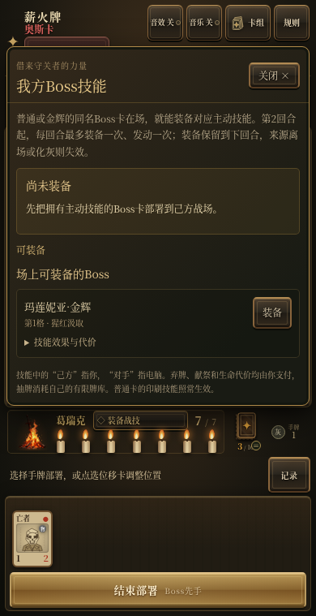
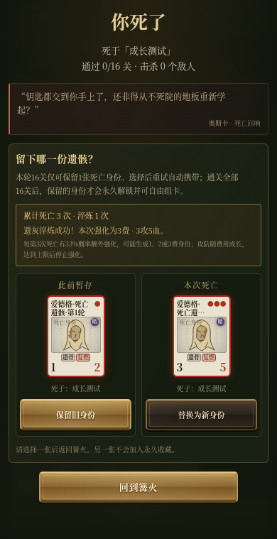
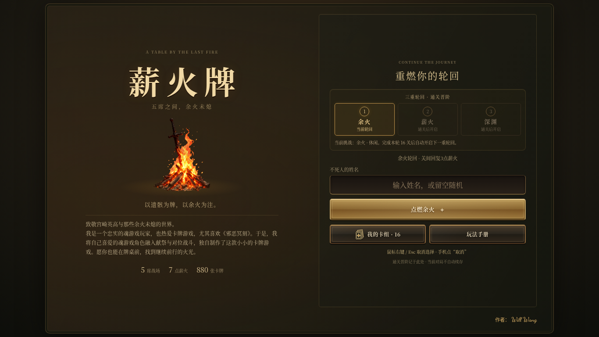
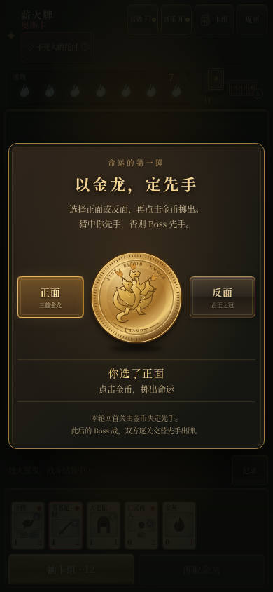
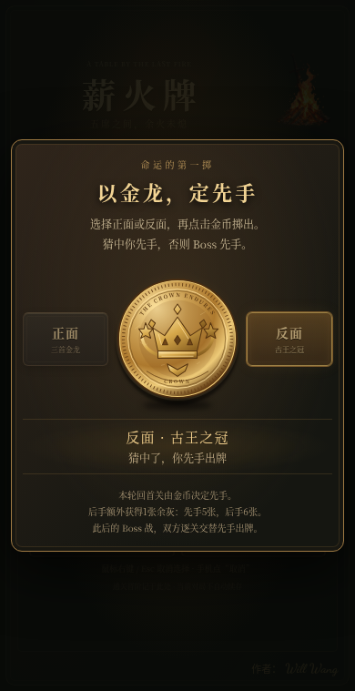
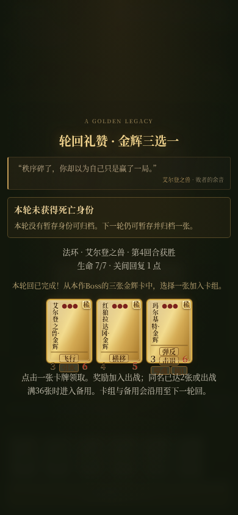

# 薪火牌 · 中英文与双语搜索 0.18.3

[index.html](index.html) 是网站轻量入口，配合[assets/](assets/)中的核心程序、样式与可延后媒体，无需构建命令或后端。网站发布请整包上传；离线试玩ZIP保留完整内嵌单文件。

## 试玩与下载

- [打开试玩网页](https://flightwilliams.github.io/FlightWilliams/game/)
- [下载Cloudflare网站部署ZIP](https://github.com/FlightWilliams/FlightWilliams/raw/refs/heads/main/game/xinhuo-web.zip) · [逐步发布说明](CLOUDFLARE.md)。
- [下载试玩ZIP](https://github.com/FlightWilliams/FlightWilliams/raw/refs/heads/main/game/xinhuo-demo.zip)，解压后打开 index.html。
- [试听三十首原创轮回配乐](music/index.html) · [曲目与播放说明](MUSIC.md)。
- 作者：Will Wang。

## 0.18.3 更新

音效按钮旁加入中英文切换，首页保留语言按钮；988张牌及主要界面提供英文。图鉴与卡组搜索始终支持中文、英文名称与能力／属性关键词，英文不区分大小写。语言偏好保存在浏览器；旧存档、牌组和战斗规则保持。

`python3 build.py`可重新生成网站、单文件与两个部署包；浏览器检查使用 `GAME_TEST_URL=http://127.0.0.1:8893/index.html node tests/language_check.cjs`。

[本次更新](UPDATE-0.18.3.md)

## 0.18.2 更新

入口约6KB，首页先显示，核心逻辑与可选音效分开加载、缓存。媒体失败仍可玩，网络失败提供重试/复制链接说明。旧方法与动画受限时保留可用回退。现有卡组和战斗规则保持；新域名存档独立。提供Cloudflare Pages整站部署包。

[本次修改与测速条件](UPDATE-0.18.2.md) · [Cloudflare发布步骤](CLOUDFLARE.md)

## 0.18.1 已包含的更新

修正跨回合部署的呈现：Boss后手放灰、下一回合先手献祭时，先显示新回合提示；双方余灰标注“新入场／可献祭”，献祭记录注明格子及入场回合。幽邃主教群没有当回合献祭的特权，原成熟规则保持。

[原因与验证说明](UPDATE-0.18.1.md)

## 0.18 已包含的更新

核查369张具名普通角色并补强不足的攻防，61张金辉同步调整。约兰保留暗属性与横移，劳伦斯保持火焰与反击风格；罗德里克基础0攻，对位存活卡攻击为0时改为3攻，空位仍0攻。每种金辉在出战与备用合计只保留1张，已拥有的不重复奖励。

敌我主动技能都消耗1张未冻结的手牌余灰，成功后停用下一完整回合，再下一回合可用。护盾受一次攻击后失效。取消普通敌人死亡自动补灰，统一新祭品成熟检查、先后手与存活实例的攻击结算。

每次保存均采用最近卡组。主线在完成的出牌节点和关卡结束后自动保存，刷新恢复未完成进度、场面和待领奖励。首页或第一关可重战已击败的单个Boss，未通关的锁定，重战不覆盖主线。新手指引更新为16项。

[完整更新说明](UPDATE-0.18.md) · [具名角色逐卡调整](CARD-QUALITY.md) · [30首配乐试听](music/index.html)

## 0.17 已包含的更新

每个轮回每四位Boss更换主题，按第1–4、5–8、9–12、13–15关分段播放，第16关保留专属最终Boss曲。六轮共30首，本版补充18首独立原创合成乐曲；魂Ⅰ、魂Ⅱ、魂Ⅲ、血源、只狼与法环各自保持风格，并随冒险深入变化。

跨段自动淡入淡出，音乐继续在本地合成，无额外音轨下载。音乐按钮说明显示当前曲名与关卡段。独立静音、后台暂停恢复及现有存档功能保持。

[试听30首](music/index.html) · [曲目与关卡表](MUSIC.md) · [本版说明](UPDATE-0.17.md)

## 0.16 已包含的更新

96位Boss分别配置专属随从、主题和配合技能的战术，按关卡层级组成16／18／20张有限牌组；至少55%为低费卡，保留原有卡牌数值与保护优势牌的电脑决策。Boss技能说明里增加牌组主题。[查看96组配牌](BOSS-DECKS.md)。

正式死亡累计保存，每第3次死亡有33%概率强化本次死亡身份，可生成1费、2费或3费，已获得身材不倒退。保留每轮一张暂存身份、通关16关才永久归档的规则，死亡页展示计数与结果。

自己的同名普通或金辉Boss卡在场时，点我方生命旁的“装备战技”，选择并装备对应主动技能。装备成功后说明自动收起，按钮变成“发动战技”；电脑悬停或手机点按可先看效果，再点击提示中的发动按钮确认。发动后，相关卡牌的攻击、生命或费用变化会显示数字动画。第2回合起，每回合最多装备一次；成功发动消耗手牌余灰并冷却下一完整回合，来源卡离场或化灰后失效。部署技能点击发动，攻击后技能先准备、攻击结束后结算，目标与代价按我方视角计算。新手导览扩充为14项，加入技能装备和死亡成长说明。

[本版完整说明](UPDATE-0.16.md) · [Boss技能表](BOSS-SKILLS.md)

## 0.15 已包含的更新

六个轮回各有一首原创合成主题曲，第16关另有一首更紧张的最终Boss曲，共12首。第1～15关连续使用本轮主题，普通关卡之间不从头重播；最终Boss关淡入淡出换曲。音乐开关与音效独立并记忆设置，后台暂停、返回续播；浏览器首次播放需先有一次点击。音乐在本地合成，不额外下载音轨。主HTML由原约4.41MB缩小至2.57MB。可在[试听页](music/index.html)播放、下载单轮淡出的MP3；[MUSIC.md](MUSIC.md)列出全部曲目、时长与制作说明。

卡牌“火防女”统一更名为“防火女”，旧收藏、自定义卡组与跨轮回牌组通过别名迁移，数值与技能保持不变。金辉卡在手牌、刚落桌和敌我战场上均保留金色卡面，右上角显示“稀”字；金辉版与普通版使用同一角色头像。

头像按卡牌名称、介绍与角色类型组织：人形区分骑士、法师、盗贼、亡灵等头像，动物采用对应物种的头部特征，Boss加入各自的外貌与装备特征。头像为新增SVG绘制，原有数值和战斗规则不随图案改变。

每轮首关掷币加入原创“叮”和旋转落币音效，受音效开关控制。金币落定后化作一张余灰飞给后手者：部署前先手5张、后手6张。额外余灰不消耗牌库，不自动上桌，也不能刚部署就献祭；新手指引和规则手册同步说明。

保存自选卡组、关间调整或领取奖励后，立即将出战卡组与备用牌写入本地存档。下一关、回首页、刷新、死亡重试和下一轮回沿用保存的牌组，不再恢复为16张初始卡。暂存死亡身份仍按每轮一张管理。金币选择正面可预览金龙、反面可预览皇冠；修复了反面被错误显示为镜像金龙的问题。

## 六个世界，96位守关者

本版按黑暗之魂Ⅰ、黑暗之魂Ⅱ、黑暗之魂Ⅲ、血源诅咒、只狼、艾尔登法环排列六个轮回，每轮16关。通关当前轮回后开启下一轮，难度与电脑决策逐轮提高。魂Ⅰ包含奥斯卡、帕奇、索拉尔等NPC对战；只狼纳入赤鬼、火牛等精英敌人。

所有96位关卡Boss都有实装主动技能、战败余音与玩家死亡回响。技能显示在Boss红名旁；电脑悬停或点击、手机点按可查看效果、时机、代价和本轮状态。第2回合起成功发动消耗1张未冻结手牌余灰，随后跳过下一完整回合再可使用；没有目标或代价不足时不发动。主动技能与同名卡牌的印刷技能分别计算。

电脑在全部关卡评估献祭前后的场面，优先保留优势牌与阻止致命直击的阻挡者；随轮回推进，出牌、落点、走位与资源规划更深入。关间恢复逐步收紧，后期敌军也获得额外战斗强化。

## 空牌桌与金龙币

双方由空牌桌开场，不再预放余灰或怪物。双方基础起手各5张：4张卡组牌与1张余灰；首回合无需抽牌。双方自行部署，新出场的卡须存活到下一回合才能献祭。

每轮回首关先选择金币旁的“正面”或“反面”，再点击金币投掷。结果在牌桌中央显示：猜中则玩家先部署并先攻，否则Boss先部署并先攻。金币采用受金龙币启发的原创金色龙纹与王冠双面设计，掷出时响起原创叮声和旋转声，遵守音效开关。

本轮首关金币落定后，会化为一张额外余灰交给后手。部署前先手5张、后手6张；若Boss先手，它部署后手牌数量会相应减少。补偿不消耗有限牌库，需要玩家或Boss自行部署，存活到下一回合才可献祭。此补偿只发生在首关掷币时，后续Boss关交替开场先手，不再额外补灰。

之后每位Boss的开场先手交替；同一场战斗内，每回合也交换先部署与先攻的一方。双方完成部署后才结算攻击，每张存活卡每回合最多攻击一次。先手改变实际部署和攻击顺序。

## 每轮通关，金辉三选一

每个轮回第16关通关后，提供最多三张尚未拥有的本作Boss金辉，选择一张；当前最终Boss的金辉尚未获得时会优先列入。剩余不足三张按实际数量提供，全部获得后改为普通候选。六个轮回均采用此规则。普通关卡奖励仍有5%概率出现当前Boss金辉，三张候选选一张。

基础卡库共988张角色卡：880张普通卡、108张金辉卡。96位新关卡Boss各有金辉版本；旧版恶魂与黄金树幽影的12张金辉继续保留，已有收藏和牌组可继续使用。新增60张金辉，攻防高于对应普通版，费用不高于普通版。名称与卡库数量继续沿用；0.18具名角色与对应金辉的补强见[CARD-QUALITY.md](CARD-QUALITY.md)，一般小怪与无名精英保持原值。

金辉牌有金色边框、箔面与星点，右上角以“稀”字标记；刚出场也不会被普通新牌滤镜褪色，敌我战场保持金辉外观。减少动画模式停用扫光。击杀成长只由自身攻击击杀敌卡触发，每击杀增加1攻，仅本次战斗有效；直击生命、献祭与中毒击杀不触发。亡语在死亡和献祭时触发，敌我一致。小蜘蛛、金色余灰等衍生物不计入108张收集卡；本回合诞生须到下回合才可献祭。

## 96位Boss名单

| 关卡 | 魂Ⅰ | 魂Ⅱ | 魂Ⅲ | 血源 | 只狼 | 艾尔登法环 |
|---:|---|---|---|---|---|---|
| 1 | 奥斯卡 | 最后的巨人 | 灰烬审判者古达 | 教会野兽 | 赤鬼 | 黄金树守卫 |
| 2 | 不死院恶魔 | 追逐者 | 冷冽谷的玻尔多 | 加斯科因 | 鬼刑部 | 玛尔基特 |
| 3 | 牛头恶魔 | 流放罪执行者 | 结晶老者 | 渴血兽 | 火牛 | 葛瑞克 |
| 4 | 钟楼石像鬼 | 遗忘的罪人 | 幽邃主教群 | 阿梅利亚 | 蝴蝶夫人 | 红狼拉达冈 |
| 5 | 帕奇 | 骷髅王 | 深渊守望者 | 汉威克女巫 | 弦一郎 | 蕾娜拉 |
| 6 | 索拉尔 | 毒妃米妲 | 霸王沃尼尔 | 雅南暗影 | 屏风猿猴 | 拉塔恩 |
| 7 | 月光蝶 | 熔铁恶魔 | 教宗沙力万 | 罗姆 | 狮子猿 | 龙装大树守卫 |
| 8 | 魔女克拉格 | 铁之古王 | 巨人尤姆 | 重生之古神 | 无首狮子猿 | 蒙葛特 |
| 9 | 铁傀儡 | 公爵的芙蕾雅 | 冷冽谷的舞娘 | 米克拉什 | 破戒僧 | 拉卡德 |
| 10 | 奥恩斯坦 | 腐败物 | 猎龙铠甲 | 梅尔戈乳母 | 枭 | 莫格 |
| 11 | 斯莫 | 镜之骑士 | 洛斯里克王子 | 格曼 | 宫内破戒僧 | 火焰巨人 |
| 12 | 墓王尼特 | 娜香德拉 | 无名王者 | 月之魔物 | 神龙 | 玛利喀斯 |
| 13 | 亚尔特留斯 | 王兄安第尔 | 薪王们的化身 | 路德维希 | 艾玛 | 葛孚雷 |
| 14 | 卡拉米特 | 烟之骑士雷姆 | 修女芙莉德 | 玛丽亚 | 义父 | 玛莲妮亚 |
| 15 | 深渊之主马努斯 | 骑士亚伦 | 黑龙米狄尔 | 劳伦斯 | 怨恨之鬼 | 拉达冈 |
| 16 | 薪王葛温 | 灼烧的白王 | 盖尔 | 科斯孤儿 | 一心 | 艾尔登之兽 |

技能效果、发动条件与代价见[96位Boss技能表](BOSS-SKILLS.md)。[boss-abilities.json](boss-abilities.json)保留完整技能配置，包含旧版兼容记录；[campaigns.json](campaigns.json)给出当前六轮顺序。

Boss死亡余音和玩家失败回响分别编写；即使死于该关小怪，失败回响仍由当前Boss发出。新生成的死亡身份保留这句回响，永久归档后仍可查看。

## 收藏、组牌与轮回继承

默认初始卡组16张，基础起手5张；本轮首关掷币后的后手额外获1张余灰。推荐出战24张，上限36张。未获得的牌以问号背面封存，不显示名称、能力或加入按钮，搜索只匹配已收藏卡。默认起始16张中的12种角色与余灰作为初始收藏。

奖励实际进入出战后才永久解锁；只进入备用时保持封存，须编入出战并保存。出战12–36张，普通同名最多2张；金辉在出战与备用合计最多1张，余灰不受同名数量限制。奖励直接加入卡组，达到36张才提示整理；已满36张或同名已达2张时，新奖励进入备用。可按费用、功能、属性与名称排序，排序仅影响显示。

通关16关后，出战卡组、备用牌和已击败Boss记录沿用至下一轮；最终奖励也会写入保存。首页“我的卡组”可编辑沿用牌组。新建初始自定义卡组保留费用、Boss比例与零费比例限制；跨轮回取得的卡组不会因初始预算被重置。

在关间管理界面点击保存或领取新奖励时，同样会保存本轮最新卡组；即使死亡后回到首页并刷新，重试仍使用这份牌组。保存的是卡组和备用牌，已完成的出牌节点与关卡结束会自动保存，待领奖励也保留。

旧版进度按已通关轮数迁移，不清空已有收藏和沿用牌组：旧版完成0／1／2轮分别继续魂Ⅰ／魂Ⅱ／魂Ⅲ，完成3轮进入血源。旧版12张恶魂／幽影金辉与死亡身份继续保留。

每个16关轮回最多暂存一张死亡身份；首次死亡自动保留，第二次及以后选择保留旧身份或替换新身份。重试只带一张暂存身份。通关本轮16关后，该身份才永久归档并可自由组卡。

## 战斗与操作

双方7点生命、五格战场。卡牌只攻击对位；飞行可越过对位直击，守护能够拦截。从第二回合起，玩家每回合免费获得一张余灰，再选择从有限卡组抽一张牌或再取无限余灰。最多36回合，之后按生命与场面裁决。

帕奇出场可冻结一张自己的手牌两回合，第三回合解冻并减1费，最低0费。介绍：“这个光头总是在你不经意时，将你推下深渊”。Boss的白王冰封独立计算，解除不附带减费。

双方弃牌堆可在战斗记录中查看。主动弃手牌不触发亡语、死亡抽牌或复燃；抽牌仍消耗有限牌堆。回收移动原实例，不复制。暂时余灰化覆盖玩家下一次完整行动，恢复原卡当前攻血与成长，不回满血、不重触入场；灰被杀或献祭后本场不再恢复，也不触发原卡亡语。

点牌堆图标打开卡组。右键、Esc或手机“取消”清除待确认选择，已完成的部署与移动不撤销。手机长按卡牌约半秒查看介绍与完整技能；锁定卡不能打开。新手先进行界面导览，再练习空桌部署余灰、等待一轮、选择抽牌与献祭召唤，可在玩法手册中重看。

击败一位主线Boss后，选择一张奖励就直接进入下一关。出战满36张时，新奖励进入备用，关间不强制打开整理页；章节末领取奖励后进入本章收尾。

点击可打出的手牌后，卡牌悬浮并跟随鼠标；点击我方合法格子落牌。手机支持先点手牌再点格子，也支持选牌后按住我方牌桌滑动预览、松手落牌。预览时拿起的卡与对位敌卡显示绿色向上／红色向下的属性箭头，落牌后保留。献祭仍需先选足够的成熟友军；取消、Esc或右键放回尚未打出的手牌。手牌横向滑动和长按详情继续可用。

界面适配桌面与手机窗口，手牌和说明独立滚动。普通选牌与祭品选择保留牌桌、手牌和篝火节点；手牌固定尺寸，不随抽牌数量变形。抽牌仅从牌堆平移到手牌，不缩放、旋转或落地弹跳，异常时也会释放输入。

首页保留对宫崎英高的致敬、对《邪恶冥刻》的创作缘起，以及右下角金色小字作者：Will Wang。

## 音效与设计来源

洗牌、抽牌、落牌使用[Kenney Casino Audio](https://kenney.nl/assets/casino-audio)纸牌录音；燃烧采用Ezwa／Dinamic的Flare火焰录音改编（CC-BY-SA 3.0）。刀剑来自audione，怪物与弓箭来自Superpowers，重击来自Kenney；圣光、灵体、法术和金辉宝石提示为原创合成。离线版内嵌上述音效，网页版随后加载同源录音；音效与音乐独立，关闭音效即时停止。逐项来源、独立改编WAV及完整许可见[audio/](audio/)。

三十首轮回音乐及首页、胜负提示段采用新谱面和程序合成，使用AI辅助作曲设计与编码，未使用官方游戏录音、外部音乐采样或官方旋律转录。游戏本地播放合成音乐，试听MP3仅在试听页点击后加载。详见[原创配乐说明](MUSIC.md)。

按钮与牌桌参考Wesnoth与Forge，成品使用原创CSS，详见[设计参考](DESIGN.md)。字体与音效许可随试玩包保留。

## 发布与验证范围

将网站部署ZIP中的index.html、assets及_headers一起上传至静态网站即可试玩；本仓库GitHub Pages发布路径为 /game/。试玩ZIP附有本版验证记录，覆盖六轮数据、技能、金币、先手顺序、奖励、继承与相关回归检查。

手机验证使用Chromium模拟视口，不代表已完成真实iPhone微信或Safari验证。收藏、晋阶、沿用牌组和死亡身份保存在当前浏览器；主线自动保存安全节点与待领奖励，没有账号或云同步。换浏览器、清站点数据或换域名会影响本地进度。GitHub Pages在不同网络环境中的可达性由网络决定。
